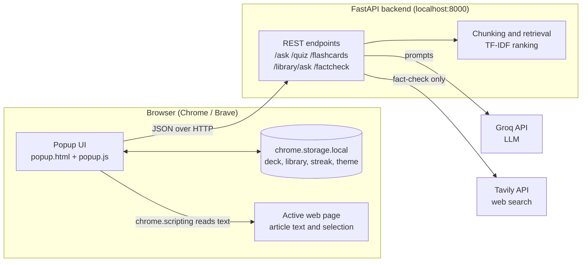
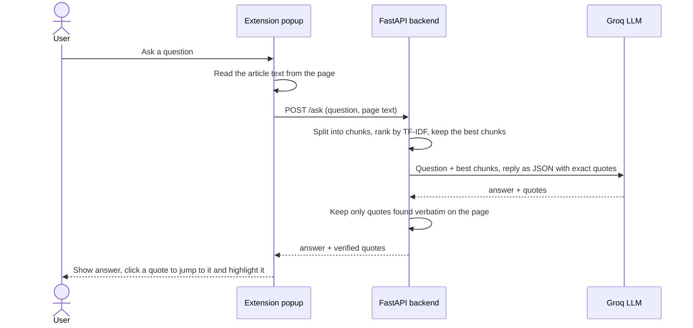
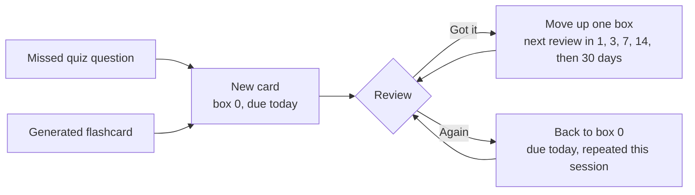
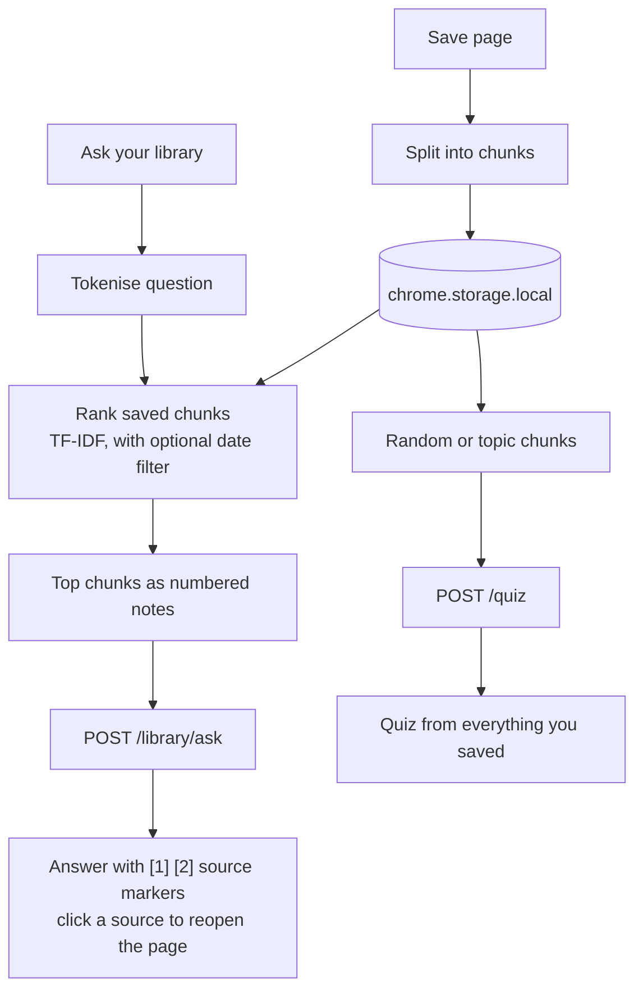
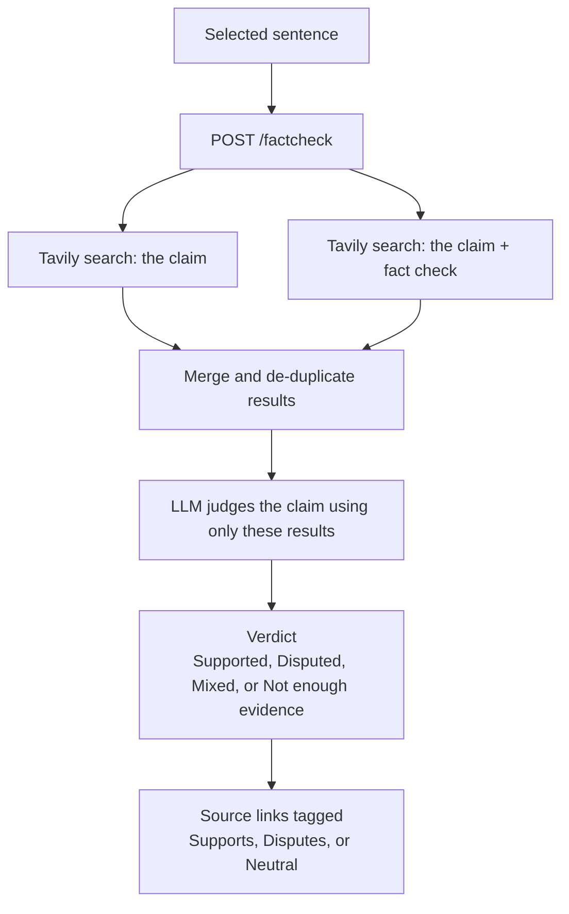

<div align="center">


# StudyLens - Smarter Extension

**A browser extension that helps you read and learn smarter, verify claims, and actually remember what you learn.**


</div>

---

## Overview

Most "chat with a webpage" tools stop at a single answer. StudyLens covers the whole study loop:

**read → understand → verify → remember → revise**

Open any article, ask questions about it, get answers backed by the exact sentences on the page, turn the page into quizzes and flashcards, save it to a personal library, and fact-check any claim against the live web.

It was built with exam-prep students in mind, so quizzes and flashcards can be generated in **English, Hindi, or Hinglish**.

## Screenshots

<!-- Add your screenshots to docs/screenshots/ using these file names. -->

| Ask with citations | Quiz |
|---|---|
| ![Ask]
 | ![Quiz]
| Flashcards and review | Library |
|---|---|
| ![Cards]
 | ![Library]
 
| Fact-check | Light theme |
|---|---|
| ![Fact-check]
 | ![Light theme]

## Features

| Tab | What it does |
|---|---|
| **Ask** | Ask a question about the page you are reading. Every answer comes with exact quotes from the page. Click a quote and the page scrolls to that sentence and highlights it. Works on long articles too. |
| **Quiz** | Generates multiple-choice questions with explanations from the current page. Questions you get wrong are saved to your flashcards automatically. |
| **Cards** | Generates flashcards and reviews them with spaced repetition. Correct answers come back after 1, 3, 7, 14, then 30 days. Missed cards come back the same day. |
| **Library** | Save pages to a personal library. Ask questions across everything you saved, filter by time range, or take a quiz built from your saved pages. |
| **Check** | Select a sentence on any page and fact-check it. StudyLens searches the web and returns a verdict with links to sources that support or dispute the claim. |

Also included: a daily **study streak** and a **dark / light theme** toggle (dark by default).

## How it works

### System architecture

The extension reads the page and keeps your personal data in the browser. The backend only does the AI work and keeps no data.



### Ask: answers with verified citations

The model is asked to return its answer plus word-for-word quotes. The backend then checks that each quote really exists on the page and **drops any quote that does not**, so a made-up citation is never shown.



### Flashcards and spaced repetition

Cards live in browser storage. Each card has a box number that decides when it is shown next.



### Library: save, search, and quiz across pages

Saved pages never touch the backend. Search runs inside the extension, and only the few best-matching chunks are sent to the backend to write the answer.



### Fact-check

The verdict is based **only on the search results**, not on the model's memory, and every source link comes from a real search result.



## Tech stack

| Layer | Technology |
|---|---|
| Extension | Chrome Extension (Manifest V3), vanilla JavaScript, HTML, CSS |
| Backend | Python, FastAPI, Uvicorn, Pydantic |
| LLM | Groq API (default model `openai/gpt-oss-120b`, configurable) |
| Web search | Tavily API |
| Storage | `chrome.storage.local` (deck, library, streak, theme) |
| Retrieval | Custom paragraph chunking with TF-IDF style ranking |

## Project structure

```
StudyLens/
├── backend/
│   ├── main.py              # FastAPI app: all AI endpoints and retrieval helpers
│   ├── requirements.txt
│   └── .env                 # your API keys (not committed)
├── extension/
│   ├── icons/               # extension icons (16, 48, 128 px)
│   ├── manifest.json        # extension settings and permissions
│   ├── popup.html           # layout and styling (dark and light themes)
│   └── popup.js             # all extension logic
├── docs/
│   └── screenshots/         # images used in this README
├── .gitignore
└── README.md
```

## Getting started

### Prerequisites

- Python 3.10 or newer
- A Chromium browser (Chrome, Brave, Edge)
- A free [Groq API key](https://console.groq.com/keys)
- A free [Tavily API key](https://tavily.com) (only needed for fact-check)

### 1. Clone the repository

```bash
git clone https://github.com/<your-username>/StudyLens.git
cd StudyLens
```

### 2. Create a virtual environment and install dependencies

```bash
python -m venv venv

# Windows (PowerShell)
venv\Scripts\activate
# macOS / Linux
source venv/bin/activate

pip install -r backend/requirements.txt
```

### 3. Add your API keys

Create a file named `.env` inside the `backend` folder:

```env
GROQ_API_KEY=your_groq_key_here
GROQ_MODEL=openai/gpt-oss-120b
TAVILY_API_KEY=your_tavily_key_here
```

No spaces around `=` and no quotes. Groq changes its model lineup from time to time, so if you get a "model not found" error, pick a current model from the [Groq models page](https://console.groq.com/docs/models) and update `GROQ_MODEL`.

> Never commit `.env`. It is already listed in `.gitignore`.

### 4. Start the backend

```bash
cd backend
uvicorn main:app --reload
```

Wait for `Application startup complete`, then check http://127.0.0.1:8000/health. Interactive API docs are at http://127.0.0.1:8000/docs. Keep this terminal open while you use the extension.

### 5. Load the extension

1. Open `chrome://extensions` (or `brave://extensions`).
2. Turn on **Developer mode**.
3. Click **Load unpacked** and select the `extension` folder (the one that contains `manifest.json`).
4. Pin **StudyLens** from the puzzle-piece menu.

### 6. Use it

Open any normal article, **refresh the page once**, and click the StudyLens icon.

- **Ask**: type a question and press Ask.
- **Quiz / Cards**: choose a count and language, then generate.
- **Library**: save the page, then search across everything you saved.
- **Check**: highlight a sentence on the page, open the Check tab, and press Check claim.

Browser pages such as `chrome://` or `brave://` cannot be read by extensions.

## API reference

| Method | Endpoint | Body | Returns |
|---|---|---|---|
| GET | `/health` | none | Server status and the model in use |
| POST | `/ask` | `question`, `page_text`, `url` | `answer`, verified `quotes` |
| POST | `/quiz` | `page_text`, `count`, `language` | `questions` (4 options, answer index, explanation) |
| POST | `/flashcards` | `page_text`, `count`, `language` | `cards` (front and back) |
| POST | `/library/ask` | `question`, `notes[]` | `answer` with `[n]` source markers |
| POST | `/factcheck` | `claim` | `verdict`, `summary`, tagged `sources` |

## Design decisions

- **Verified citations.** Quotes returned by the model are checked against the page text and discarded if they do not match exactly.
- **Stateless backend, local-first data.** Your deck, streak, theme, and saved pages live in the browser. The backend stores nothing, which keeps it simple and private.
- **Smarter long pages.** Articles are split into chunks. Ask retrieves the chunks that best match the question, while quizzes and flashcards sample chunks evenly across the whole page instead of only the beginning.
- **Evidence-only fact-checking.** The model must judge the claim from retrieved search results, and the extension always shows the links so you can confirm.
- **No heavy dependencies.** Retrieval uses a lightweight keyword scoring method, so setup is a quick pip install with no large ML packages.

## Privacy

- The text of the page you ask about (or the chunks you select) is sent to **Groq** to generate answers, quizzes, and flashcards.
- A claim you fact-check is sent to **Tavily** to search the web.
- Your library, flashcards, and streak stay in your browser. There are no accounts and no analytics.

## Limitations

- The backend must be running locally for the extension to work.
- Library search matches **words**, not meaning, so questions work best when they use words that appear in the saved text.
- Only part of a very long page is sent to the model in a single request.
- AI output can be wrong. Use the citations and fact-check sources to confirm anything important.
- Free API tiers have rate limits.

## Roadmap

- [ ] Host the backend so no local setup is needed
- [ ] Semantic search with embeddings in the library
- [ ] Local / private mode with Ollama
- [ ] Daily revision reminders for due cards
- [ ] Export flashcards to Anki and CSV
- [ ] Chrome Web Store release

## Author

Built by **Nishu**.
